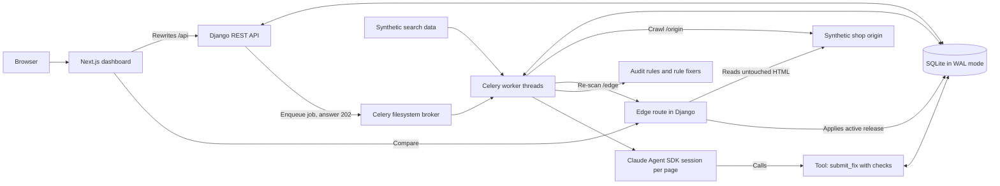

# Sitemend

Sitemend scans a site, writes checked SEO fixes, ships the approved ones at the edge as numbered releases, proves them with a re-scan and rolls them back in one click.


Full video: https://github.com/ArchiusVuong-sudo/sitemend/releases/download/v0.1/demo.mp4

## What it does

- Crawls a bundled synthetic shop (12 pages, a 2-hop redirect, 2 missing pages) as a background job, checks every page against 9 rules and shows a 0-100 site grade with Technical, On-page and Rich results scores. Each issue keeps the HTML that proves it.
- Ranks issues by what they cost in search, from labelled synthetic search data: impressions, click-through rate against the median for the same position band, and severity. Every row explains its rank in one line.
- Fixes technical issues with rules (canonicals, broken and redirecting links, a second H1, social tags, Product structured data) and has the model write titles, meta descriptions and alt text. Every text goes through checks before it can ship: length, target query, unique on the site, no numbers or claims missing from the page, never-use words and filler phrases.
- Each category runs on Autopilot, Approval or Off. Passing, confident fixes on autopilot ship on their own; anything with a failed check or a low-confidence match waits. Reviewers edit inline with live checks, approve, reject or approve a whole category.
- Deploy makes an immutable release that the edge applies to the untouched origin HTML. Verify re-scans the edge and marks each fix Verified live. Reverting one fix or rolling back to an earlier release makes a new release whose pages match the earlier one byte for byte.
- The Runs view shows every Celery task, page fetch, model session and tool call as spans, with p50 and p95 per step across runs.

## Architecture



## How it works

**Data model.** `Site`, `Page` (the origin snapshot of the latest scan), `SearchStat` (synthetic), `Run` (scan, generate, deploy, verify, revert, rollback), `Issue` (per scan, keyed by page, rule and target), `Fix` with its `FixAttempt` rows, `Policy` per category, `TextClaim`, `Release` and `Span`. Job state lives in `Run`, so Celery needs no result backend.

**Jobs.** The API creates a `Run`, enqueues a Celery task and answers 202 with the run id; the dashboard polls it. Celery runs on kombu's filesystem transport with a thread pool, so there is no Redis or Docker. Page fetches retry with backoff and network errors retry the whole task. SQLite runs in WAL mode with IMMEDIATE transactions and a busy timeout, because the API and worker threads write at the same time.

**Rules and rule fixers.** Nine rules read each page with selectolax. Rule fixers produce an operation for the edge plus a readable before and after. Each one is dry-run on the origin page and the rule is run again on the result, so a fix that would not clear its issue shows a failed check. A broken link with a near match is relinked; one with no close match is removed with its text kept and marked low confidence.

**Model-written text.** One Claude Agent SDK session per page writes everything that page needs, at most 3 sessions at once. The model can only call one tool, `submit_fix`, served from an in-process MCP server. The tool runs the checks and answers with reasons, so the model revises inside the same session, up to 3 tries per item; after that the fix goes to a person. Uniqueness is enforced by a database unique constraint on a `TextClaim` row, so two parallel sessions cannot ship the same title. The site's custom instructions and never-use words go into the prompt. Each session stores latency, tokens, turns, retries and the cost the SDK reports.

**Locked-down sessions.** No built-in Claude Code tools (`tools=[]`), only the app's tool in `allowed_tools`, empty setting sources, strict MCP config, no session persistence, a fresh temp working folder, bounded turns and the `dontAsk` permission mode, which denies anything not pre-approved. The CLI starts through a small wrapper that clears the environment and passes only `PATH`, `HOME`, `USER`, `LANG`, `TMPDIR` and `ANTHROPIC_API_KEY` when set. Overloaded, rate-limit and 5xx errors retry with backoff and jitter; a session that still fails sends its fixes to review with the error kept on the span.

**Live and replay.** One provider interface has two implementations. Live uses the SDK on the local Claude Code login or `ANTHROPIC_API_KEY`. Replay serves sessions recorded from a real live run (`backend/fixtures/replay`, written by `make record`) and sends the recorded text through the same `submit_fix` checks, so checks always run for real. The app picks replay when `DEMO_REPLAY=1` or no login is found, and shows a Replay mode badge.

**Edge releases.** A release is an ordered list of operations that is never edited. The edge route reads the origin HTML and splices each change in at exact character offsets, so every byte it does not touch stays as the origin sent it, and an empty release returns the origin unchanged. Social tags and Product JSON-LD are derived when the page is served, from the final title and description and from data visible on the page, so they never go stale or invent facts. Every edge response names its release in `X-Sitemend-Release`.

**Grade and priority.** Each page has check slots per group; a failed slot costs its worst severity. The site grade is 40% Technical, 40% On-page and 20% Rich results. Priority is `log10(impressions + 1) x (1 + 2 x CTR gap) x severity`, where the gap compares the page's CTR with the median of the site's pages in the same position band. Unit tests pin both formulas.

**Trade-offs.** SQLite and a filesystem broker keep the demo to one command with no services to install; Postgres and Redis drop in through settings. One session per page, rather than one per field, gives the model the whole page context and keeps cost down. Rewriting at the edge leaves the origin untouched and makes rollback a pointer change instead of a content migration.

## Run it

Needs `uv` (Python 3.12 is fetched by uv), Node 22 and npm. Live mode needs a Claude Code login on this machine or `ANTHROPIC_API_KEY`.

```bash
make install          # uv sync --frozen and npm ci
make start            # next build, then gunicorn, the Celery worker and next start
make start-replay     # same, with recorded model sessions (no login or key needed)
```

Open http://127.0.0.1:4124. All three processes log with a prefix and a readiness check prints when the app answers. `make dev` runs the same three with `runserver` and `next dev`.

| Variable | Default | What it does |
| --- | --- | --- |
| `PORT` | `4124` | Dashboard port |
| `API_PORT` | `14124` | Django API port (the dashboard proxies to it) |
| `SITEMEND_MODEL` | `claude-sonnet-5-5` | Model for titles, descriptions and alt text (`claude-opus-5-5` and `claude-haiku-5-5` also work) |
| `DEMO_REPLAY` | `0` | `1` forces replay mode |
| `ANTHROPIC_API_KEY` | unset | Used for live mode when there is no local login |
| `SITEMEND_MAX_SESSIONS` | `3` | Model sessions at once |
| `SITEMEND_SESSION_TIMEOUT_S` | `180` | Timeout per session |
| `SITEMEND_VAR_DIR` | `./var` | SQLite database and broker files |

`make record` re-records the replay fixtures from a live run on a scratch database. `make reset` (or Settings, Reset demo) clears scans, fixes and releases.

## Tests

```bash
make test                                        # pytest, TypeScript type check and lint
cd backend && LIVE=1 uv run pytest tests/test_live.py   # opt-in: one real model session
cd frontend && npm run e2e                       # browser test, with make start-replay running
```

The backend suite runs in replay mode with Celery in eager mode and no network. It covers every rule and the scan against the planted-issues manifest (no misses, no extras), each text check, the rewriter (empty release unchanged, only targeted bytes change, derived tags), rule fixers and their dry runs, the priority and grade formulas, attempts and parallel uniqueness claims, the autopilot policy, the locked-down SDK options and the CLI flags they produce, the environment allowlist, retries, replay and sign-in fallback, the API, tracing, and the full loop: scan, generate, autopilot release, edit, approve, deploy, verify, revert and a rollback whose pages match the earlier release byte for byte. The browser test walks the same loop through the dashboard at 1440x900 and fails on any console error.

## Notes

- Everything is synthetic: Mossgrove Clayworks is a made-up shop on a reserved `.example` domain, and the search numbers are invented to tell a clear story. Grades, priorities, issue counts and fix counts shown in the app are computed from this data and the app's own runs.
- It does not read real search data, connect to a CMS, ping search engines or crawl outside its own origin mount.
- A production version would add per-tenant sites with real crawling (robots, rate limits, JavaScript rendering), search data from a real source, and a CDN worker or proxy in place of the Django edge route.
- It would also move to Postgres and Redis, add auth and audit logs on approvals, and export spans to a tracing backend with alerts on p95 and error rates.
- The model sometimes needs a second try; the checks catch made-up claims and numbers, but a person still reviews titles and descriptions by default.
